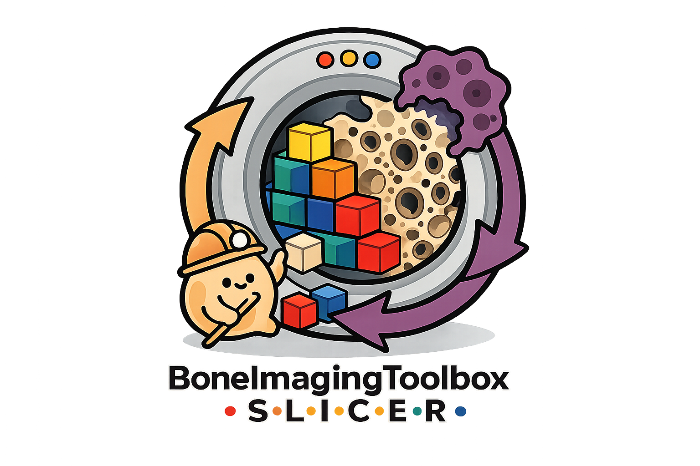

<p align="center">
  
</p>

# Bone Imaging Toolbox for 3D Slicer

Bone Imaging Toolbox is a 3D Slicer extension for bone-imaging workflows. It provides Slicer interfaces for Scanco image import/export, dataset normalization, batch processing, contouring, deep-learning segmentation, longitudinal remodelling, microarchitecture, voidspace analysis, individual trabecular segmentation, finite element analysis, mechanoregulation, motion grading, and CT spine segmentation.

The toolbox appears in Slicer under the `Bone Imaging` category. Reusable scientific logic lives in focused Python packages, while this repository owns the Slicer UI, scene integration, batch orchestration, setup page, and user documentation.

## What Can You Do With The Toolbox?

| Area | Capabilities and tools |
| --- | --- |
| Data preparation | [Scanco I/O](docs/tools/scanco-io.md): import **AIM, ISQ, SCV, GOBJ and RAD**; export edited images and masks to **AIM**. [Dataset Naming Helper](docs/tools/dataset-naming-helper.md): organize subjects, sessions, sites and imported contours. [Mask and Label Algebra](docs/tools/mask-and-label-algebra.md): combine masks and prepare analysis ROIs and FEA material labels. |
| Segmentation and quality control | [Motion Scoring](docs/tools/motion-scoring.md); [Contouring](docs/tools/segmentation-and-contours.md) with dual-threshold or geodesic outer contours, or [published U-Net compartments](docs/tools/deep-learning-segmentation.md). Independently generate bone-tissue segmentation with Gaussian, Laplace–Hamming or adaptive filtering. |
| Bone structure | [Microarchitecture](docs/tools/microarchitecture.md): total, trabecular and cortical BMD; bone and compartment volumes; trabecular bone volume fraction, thickness, separation, number and spacing heterogeneity; cortical thickness, porosity, pore volume and pore diameter. Full parameter list below. |
| Individual trabecular segmentation | [Plate/rod decomposition and morphometry](docs/tools/plate-rod-morphometry.md): label individual trabecular elements, recover full-thickness plate/rod maps, and quantify volumes, fractions, counts, number estimates, thickness, plate surface area, rod length, axial alignment and plate–plate/plate–rod/rod–rod junction densities. Listed as **Plate/Rod Morphometry** in Slicer. |
| Voidspace and Functional Bone | [Voidspace](docs/tools/voidspace.md): native, registered and dynamic large-voidspace analysis. [Functional Bone](docs/tutorials/functional-bone.md): microarchitecture measurements excluding large voidspace, over either the native scan or registered common scan region. |
| Longitudinal analysis | [Timelapsed Remodelling](docs/tools/timelapsed-hrpqct.md): register timepoints, support multistack workflows, generate common scan regions, and map and quantify bone formation and resorption. |
| Mechanical analysis | [ParOsol-FEA](docs/tools/parosol-fea.md): finite-element modelling, stiffness, failure load, strain-energy-density fields and load-history workflows. [Mechanoregulation](docs/tools/mechanoregulation.md): relate bone formation and resorption to local mechanical stimulus. |
| CT spine analysis | [Spine Segmentation](docs/tools/spine-segmentation-ct.md): vertebral identification and centroids, vertebral-level labels, body/process separation and cortical/trabecular compartments. |

Explore individual scans in Slicer, or use the [Batch Processor](docs/tools/batch-processor.md)
to process cohorts locally, reuse completed outputs, review maps and
measurements, and export consolidated CSV results. [Toolbox Setup](docs/installation.md)
manages the required runtime packages. Supported input formats and prerequisites
vary by tool; RAD files are projection radiographs, not calibrated CT volumes.

## CPU And GPU Support

The toolbox supports **CPU execution**, with optional **GPU acceleration** for
selected tools and stages:

| Workflow | Compute support |
| --- | --- |
| [U-Net contouring](docs/tools/deep-learning-segmentation.md), [Motion Scoring](docs/tools/motion-scoring.md) and [CT spine segmentation](docs/tools/spine-segmentation-ct.md) | PyTorch inference on **CPU**, **NVIDIA CUDA**, or **Apple MPS**, when supported by the installed runtime and hardware. |
| [Microarchitecture](docs/tools/microarchitecture.md) and [Functional Bone](docs/tutorials/functional-bone.md) | CPU processing with automatic **Apple Metal** acceleration on macOS or **OpenCL GPU** acceleration on Windows/Linux when available; otherwise CPU fallback. Acceleration covers local sphere-diameter accumulation, not the entire analysis. |
| [Individual trabecular segmentation](docs/tools/plate-rod-morphometry.md) | Compiled CPU backend, with optional **Apple Metal** acceleration for topology-preserving thinning. Other measurement stages remain CPU-based. |
| [Standard contouring and tissue segmentation](docs/tools/segmentation-and-contours.md) | **CPU**, including Laplace–Hamming filtering. Selecting a GPU for U-Net inference does not move independent tissue segmentation or contour postprocessing onto that GPU. |

**MPS** is PyTorch's Apple GPU backend; **Metal** and **OpenCL** are separate
backends used by the measurement tools and do not require CUDA or PyTorch.
MPS requires a compatible native Apple Silicon Python/PyTorch runtime, not an
Intel/Rosetta worker. OpenCL requires a working GPU-vendor driver/runtime.
Use **Auto** where offered to select an available device; an explicitly requested
unsupported device can fail instead of falling back. See the linked tool guides
for runtime requirements and acceleration scope.

<details>
<summary>Measured bone-structure parameters</summary>

### Microarchitecture

These are the 16 primary parameters reported by the Microarchitecture workflow;
availability depends on the supplied image and compartment masks.

| Measurement group | Parameters |
| --- | --- |
| Bone mineral density | Total **Tt.BMD**, trabecular **Tb.BMD**, cortical **Ct.BMD** (mg HA/cm³ for calibrated density images). |
| Bone and compartment volumes | Trabecular **Tb.BV**, **Tb.TV**; cortical **Ct.BV**, **Ct.TV** (mm³). |
| Trabecular structure | Bone volume fraction **Tb.BV/TV**; thickness **Tb.Th** (mm); separation **Tb.Sp** (mm); number **Tb.N** (1/mm); ridge-spacing heterogeneity **Tb.1/N.SD** (mm). |
| Cortical structure and pores | Thickness **Ct.Th** (mm); porosity **Ct.Po** (fraction); pore volume **Ct.Po.V** (mm³); pore diameter **Ct.Po.Dm** (mm). |

Density outputs include standard deviations. Thickness, separation, number and
pore-diameter maps also support distribution summaries: median, SD, 5th/25th/75th/95th
percentiles and minimum/maximum, where available. **Tb.N** is the reciprocal of
mean ridge spacing; its distribution columns describe the local inverse-spacing
map. See [Microarchitecture](docs/tools/microarchitecture.md) for method definitions.

### Individual trabecular segmentation

The toolbox's topology-based plate/rod workflow reports the following measurement
families alongside skeleton, full-thickness and individual-element label maps.

| Measurement group | Parameters |
| --- | --- |
| Volumes | Total compartment **TV**, bone **BV**, plate **pBV** and rod **rBV** volumes; measured element volumes are also recorded separately. |
| Volume fractions and ratios | **BV/TV**, **pBV/TV**, **rBV/TV**, **pBV/BV**, **rBV/BV**, and plate-to-rod volume ratio **pBV/rBV**. |
| Counts and number estimates | Plate, rod, junction and skeleton-graph element counts; **pTb.N**, **rTb.N** and plate-to-rod number ratio **PR.N**. |
| Element geometry | Mean plate and rod thickness **pTb.Th**, **rTb.Th**; plate surface area **pTb.S**; rod length **rTb.l**. |
| Orientation | Mean plate and rod axial alignment; alignment-weighted bone volume fraction **aBV/TV**. |
| Junction density | Plate–plate **P-P Junc.D**, plate–rod **P-R Junc.D**, rod–rod **R-R Junc.D**. |

Fractions are fractions, not percentages. Physical measurements require known
voxel spacing. Outputs also retain voxel counts, connected-component checks and
processing settings. This is the documented toolbox plate/rod method; the name
does not imply equivalence to other individual trabecular segmentation implementations.
See the [module guide](docs/tools/plate-rod-morphometry.md) for interpretation and citation.

</details>

## Documentation

Full documentation is built with MkDocs and intended for Read the Docs Community:

https://slicerboneimagingtoolbox.readthedocs.io/

Until the hosted site is enabled, browse the source docs in [`docs/`](docs/index.md).

Key pages:

- [Installation](docs/installation.md)
- [Tutorial Videos](docs/tutorials/index.md)
- [Dataset Format](docs/dataset-format.md)
- [Batch Processor](docs/tools/batch-processor.md)
- [Timelapsed HR-pQCT](docs/tools/timelapsed-hrpqct.md)
- [Motion Scoring](docs/tools/motion-scoring.md)
- [Segmentation and Contours](docs/tools/segmentation-and-contours.md)
- [Published U-Net Contouring](docs/tools/deep-learning-segmentation.md)
- [Functional Bone](docs/tutorials/functional-bone.md)
- [Scanco I/O](docs/tools/scanco-io.md)
- [Voidspace](docs/tools/voidspace.md)
- [derivative workflow contract](docs/derivatives.md)
- [Adding A Tool](docs/development/adding-a-tool.md)

## Install From A Clone

Clone this repository and link the module folders in Slicer:

```bash
git clone https://github.com/wallematthias/SlicerBoneImagingToolbox.git
```

In Slicer's Python Interactor:

```python
script = "/path/to/SlicerBoneImagingToolbox/scripts/link_local_toolbox_modules.py"
exec(open(script).read(), {"__name__": "__main__", "SCRIPT_PATH": script})
```

Restart Slicer, then open `Bone Imaging > Setup > Toolbox Setup` to install or update runtime packages.
Motion Scoring requires the `PyTorch` extension from Slicer's Extension Manager; Spine Segmentation may also use it depending on the selected runtime.

## Core Packages

The Slicer modules wrap these focused packages where possible:

- [`bone-imaging-derivatives`](https://github.com/wallematthias/bone-imaging-derivatives)
- [`bone-contouring`](https://github.com/wallematthias/bone-contouring)
- Published U-Net inference is included in `bone-contouring[unet]`, adapted from
  [Bonelab/HR-pQCT-Segmentation](https://github.com/Bonelab/HR-pQCT-Segmentation).
- [`timelapsed-hrpqct`](https://github.com/wallematthias/TimelapsedHRpQCT)
- [`bone-microarchitecture`](https://github.com/wallematthias/bone-microarchitecture)
- [`voidspace`](https://github.com/wallematthias/voidspace)
- [`plate-rod-thinning`](https://github.com/wallematthias/bone-plate-rod-thinning)
- [`parosol-py`](https://github.com/wallematthias/parosol-py)
- [`bone-mechanoregulation`](https://github.com/wallematthias/BoneMechanoregulation)
- [`MotionScoreHRpQCT`](https://github.com/wallematthias/MotionScoreHRpQCT)
- [`aimio-py`](https://github.com/wallematthias/aimio-py)
- [`spine-segment`](https://github.com/wallematthias/spine-segment)

## Citation

Use the citation that matches the workflow and results you report. Tool-specific citation guidance is maintained in the documentation.

- Timelapsed remodelling and mechanoregulation: Walle M et al. *Bone*. 2023;172:116780. doi: [10.1016/j.bone.2023.116780](https://doi.org/10.1016/j.bone.2023.116780).
- Multistack registration: Whittier DE et al. *Bone*. 2023;176:116893. doi: [10.1016/j.bone.2023.116893](https://doi.org/10.1016/j.bone.2023.116893).
- Motion grading: Walle M et al. *Bone*. 2023;166:116607. doi: [10.1016/j.bone.2022.116607](https://doi.org/10.1016/j.bone.2022.116607).
- Published U-Net HR-pQCT compartment segmentation: Neeteson NJ et al. *Scientific Reports*. 2023;13:252. doi: [10.1038/s41598-022-27350-0](https://doi.org/10.1038/s41598-022-27350-0).
- Plate/rod network morphometry: Walle M et al. *Front Bioeng Biotechnol*. 2024;12:1384280. doi: [10.3389/fbioe.2024.1384280](https://doi.org/10.3389/fbioe.2024.1384280).
- Voidspace: Whittier DE, Burt LA, Boyd SK. *Bone*. 2021;143:115785. doi: [10.1016/j.bone.2020.115785](https://doi.org/10.1016/j.bone.2020.115785).
- Dynamic voidspace: Whittier DE et al. *Journal of Bone and Mineral Research*. 2025;40(6):791-798. doi: [10.1093/jbmr/zjaf046](https://doi.org/10.1093/jbmr/zjaf046).
- Spine vertebral localization: Payer C et al. VISAPP 2020. doi: [10.5220/0008975201240133](https://doi.org/10.5220/0008975201240133).
- Spine compartment workflow: Walle M and Matheson BE et al. *GigaScience*. 2025;14:giaf094. doi: [10.1093/gigascience/giaf094](https://doi.org/10.1093/gigascience/giaf094).

## Authorship

The Bone Imaging Toolbox Slicer modules were developed by Matthias Walle. Core packages and third-party methods may have their own authorship, license, and citation requirements.

## Acknowledgements

Thanks to Mikkel Meisner Fondt for testing the toolbox on research datasets and providing detailed feedback and bug reports on dataset naming, contouring, and voidspace workflows.

## License

This extension is distributed under the MIT License. Core packages installed from PyPI or separate repositories are governed by their own license terms.
